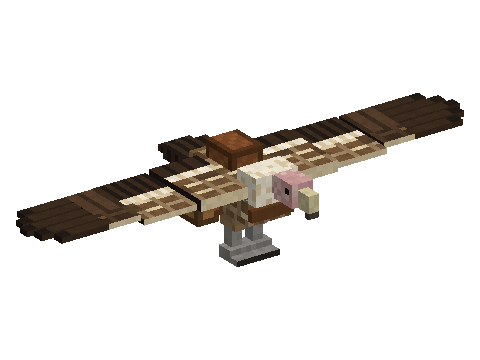
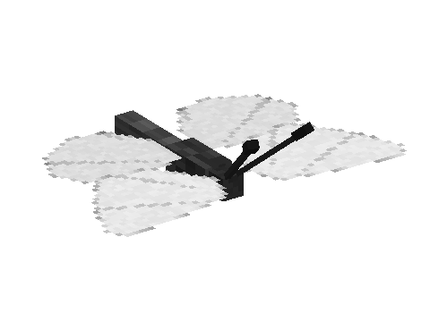
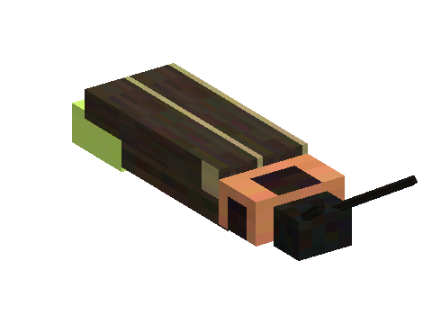
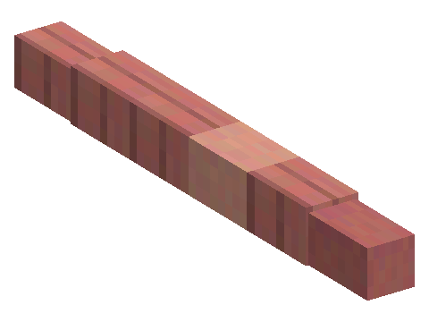
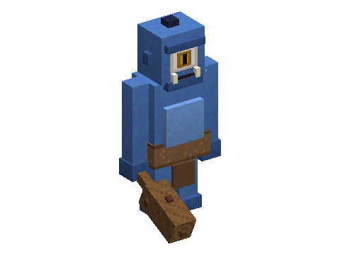
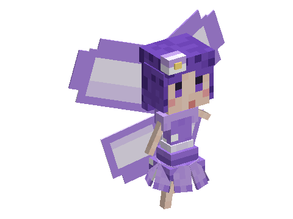

# Horizon Creature

Creature mods for [Minecraft Horizon](https://playhorizon.dev), the Rust reimplementation of Minecraft Java 26.3: a
vulture to tame and fly, butterflies and moths, fireflies, earthworms for your garden, a one-eyed giant shepherd and
shy fairies.
Install the ones you like: each works alone, with one shared library. The game text is in English and French.

| | Mod | What it adds |
|---|---|---|
|  | [Vulture](mods/vulture/README.md) | A desert vulture you tame with raw chicken, saddle and fly like a plane, with chests and talons |
|  | [Butterflies](mods/butterflies/README.md) | Butterflies by day and moths by night, in many colours and patterns; their dust makes confetti |
|  | [Fireflies](mods/fireflies/README.md) | Fireflies that light up the night, kept in a jar as a soft lantern |
|  | [Worms](mods/worms/README.md) | Earthworms you settle in your garden, where they help crops grow |
|  | [Cyclops](mods/cyclops/README.md) | A one-eyed giant shepherd at cave mouths, with its flock, its club and its boulders |
|  | [Fairies](mods/fairies/README.md) | Shy glowing fairies you befriend with glow berries: they circle your head, lighten your step and leave you fairy dust |

Planned: [Dung Beetles](mods/dung_beetles/README.md), beetles that roll dung balls under the stars and turn worn
pastures back into grass; [Sporelins](mods/sporelins/README.md), shy mushroom sprites that tend a mushroom patch;
[Seagulls](mods/seagulls/README.md), coastal food thieves that become fishing companions;
[Living Flowers](mods/living_flowers/README.md), every small and tall vanilla flower come alive, to ambush you or guard
you;
[Storm Spirits](mods/storm_spirits/README.md), spirits of living lightning born in storms, whose sparks call lightning;
[Jellyfish](mods/jellyfish/README.md), stinging jellyfish drifting in blooms, some glowing in the deep;
[Magma Golem](mods/magma_golem/README.md), a six-block giant of living magma asleep in the Nether, a mini-boss to
cool with snow;
[Vanilla Bestiary](mods/vanilla_bestiary/README.md), Minecraft's own creatures in the creature guide.

Every mod needs **[Horizon Creature](common/README.md)**, the library: it adds the glass jar, the creature guide and
the "Horizon Creature" creative tab, where all the series' items are.

## Install

1. Get the [Horizon launcher](https://playhorizon.dev).
2. In the launcher's **Mods** page, install **Horizon Creature**, then the creature mods you want.
3. Press **Play**. These are native mods: the launcher builds the game with them the first time (a few minutes).

Horizon Creature is not listed in the launcher yet. Until then, the mods can be built from this repository
([CONTRIBUTING.md](CONTRIBUTING.md)).

## In the game

- **The creature guide**: every player gets one the first time they join a world. Right-click it to open the
  **bestiary**: each creature you come across gets a page, turning in 3D, with the biomes you met it in, how rare it
  is and what you found out about it (what it eats, what catches it...).
- **The glass jar** (3 glass in a U and an oak slab, makes 2; only with Butterflies, Fireflies, Worms or Fairies
  installed): right-click a butterfly, a moth, a firefly, a worm or a fairy to catch it, right-click a block with the
  filled jar to release it. Released on a flower (or, for a worm, in a garden), it stays there. Sneak + right-click
  places the filled jar as a small glass jar holding the creature; fireflies and fairies make it glow.
- Monsters leave the series' creatures alone.
- Each mod's page tells you how to find and use its creatures.

Single player only for now; multiplayer comes later for the whole series.

## Licence

[MIT](LICENSE). The sounds come from [freesound.org](https://freesound.org), under
[CC0](https://creativecommons.org/publicdomain/zero/1.0/).

Want to help, or build the mods yourself? See [CONTRIBUTING.md](CONTRIBUTING.md).
