

  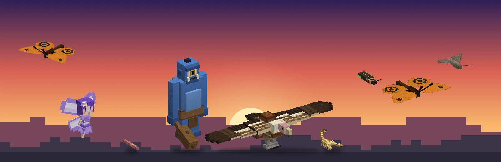

  <a href="#install"><b>Install</b></a> ·
  <a href="#the-mods"><b>The mods</b></a> ·
  <a href="#in-the-game"><b>In the game</b></a> ·
  <a href="CONTRIBUTING.md"><b>Contributing</b></a>

  
  
  
  

# Sunrise Creatures

**Creature mods for [Sunrise](https://playsunrise.net)**, the Rust reimplementation of Minecraft Java 26.3 (formerly
Horizon). A vulture to tame and fly, butterflies and moths, fireflies, earthworms for your garden, a one-eyed giant
shepherd, shy fairies, scorpions and spirits of living lightning; and Minecraft's own creatures in the guide.

- **Install the ones you like**: each mod works alone, with one shared library.
- **Native mods**, written in Rust on Sunrise's mod API, with their own models, animations, sounds and behaviours.
- **In beta**: played and tested in single player; multiplayer and balance come later.

<table>
  <tr>
    <td width="50%">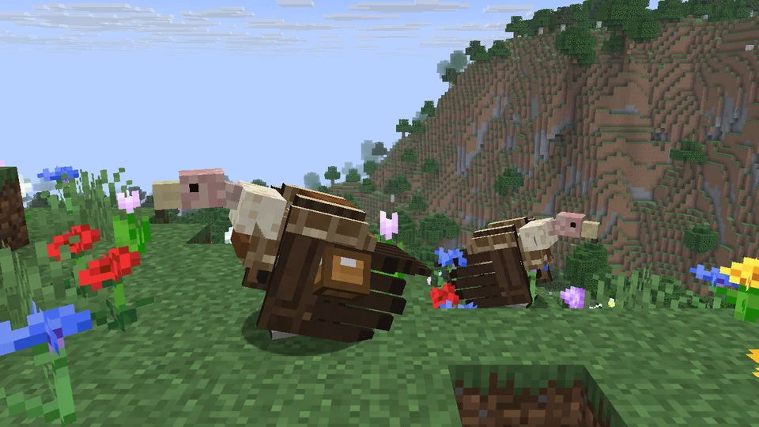 A tamed vulture, saddled, with its two chests</td>
    <td width="50%">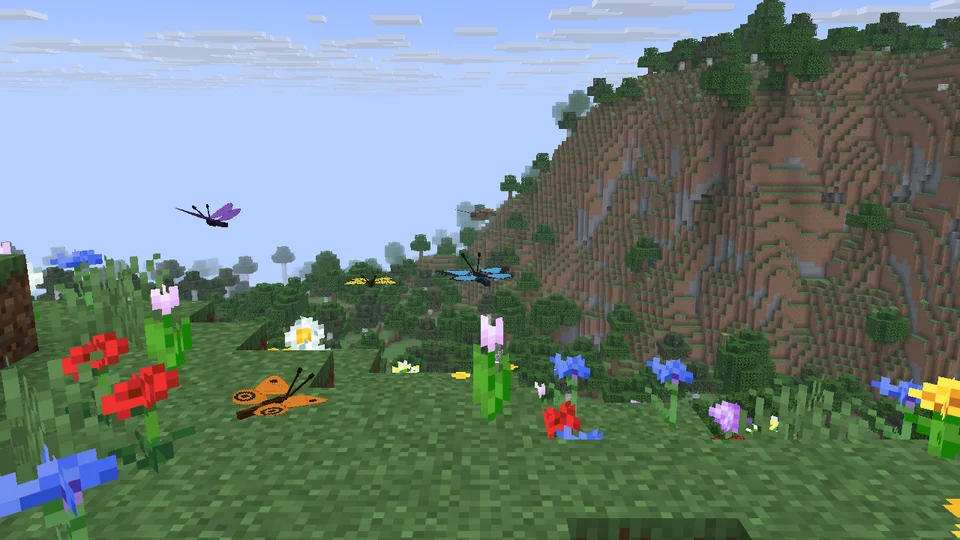 Butterflies in many colours and patterns</td>
  </tr>
  <tr>
    <td width="50%">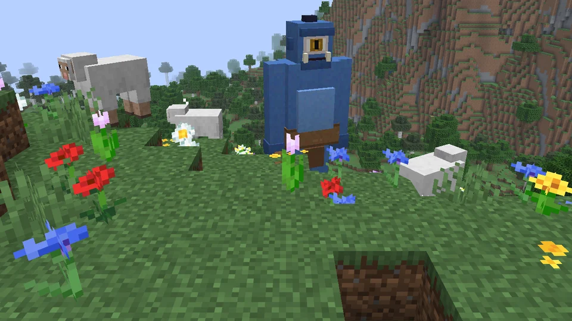 The cyclops and its flock</td>
    <td width="50%">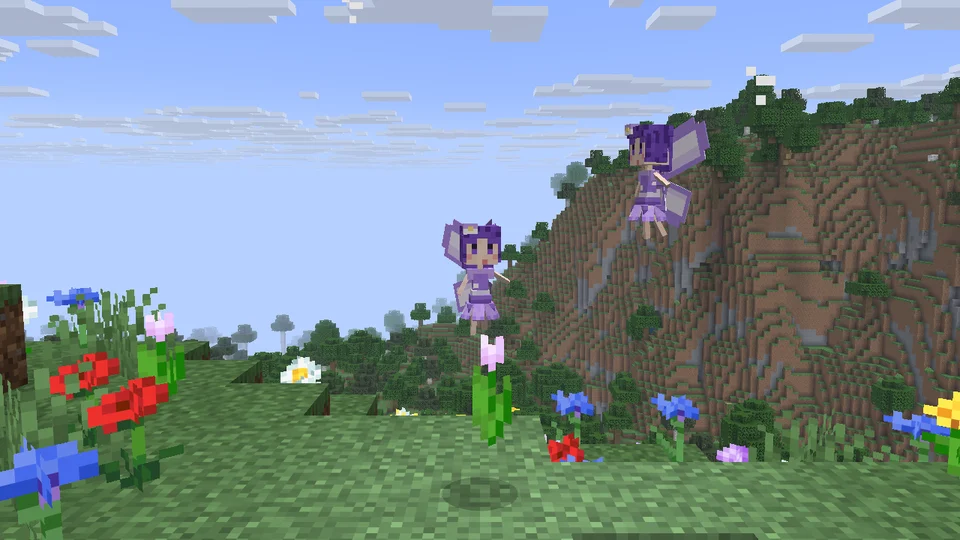 Fairies, to befriend with glow berries</td>
  </tr>
  <tr>
    <td width="50%">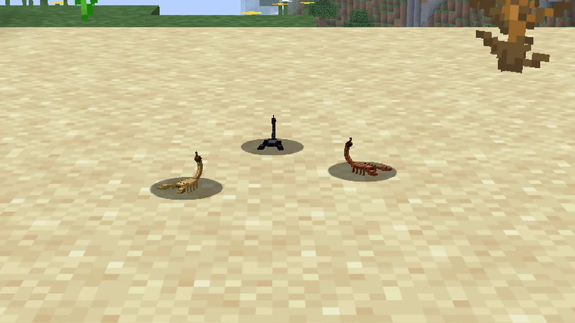 Scorpions of the desert, the badlands and the caves</td>
    <td width="50%">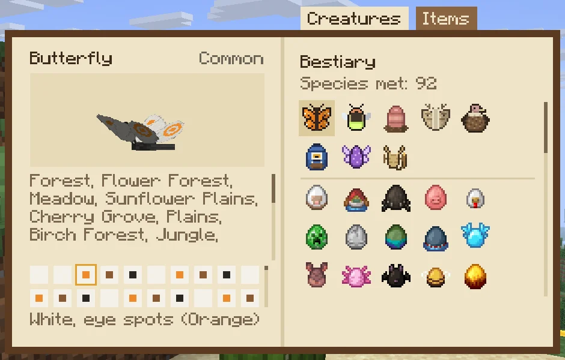 The creature guide's bestiary</td>
  </tr>
</table>

In game on Sunrise, HUD hidden.

## The mods

| | Mod | What it adds |
|---|---|---|
| 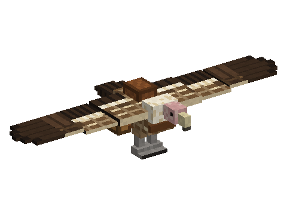 | [Vulture](mods/vulture/README.md) | A desert vulture you tame with raw chicken, saddle and fly like a plane, with chests and talons |
| 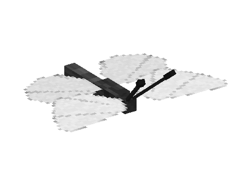 | [Butterflies](mods/butterflies/README.md) | Butterflies by day and moths by night, in many colours and patterns; their dust makes confetti |
| 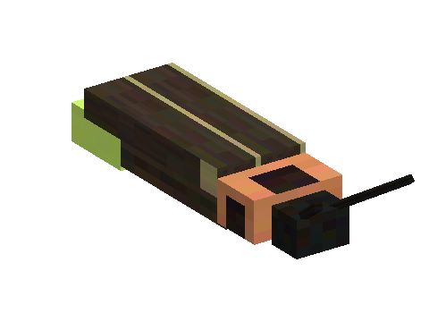 | [Fireflies](mods/fireflies/README.md) | Fireflies that light up the night, kept in a jar as a soft lantern |
| 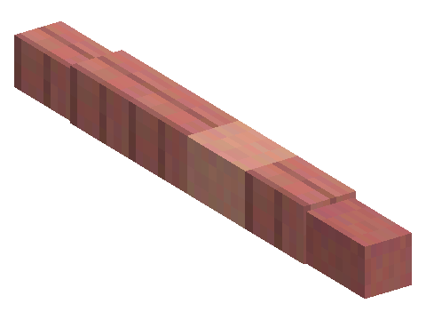 | [Worms](mods/worms/README.md) | Earthworms you settle in your garden, where they help crops grow |
| 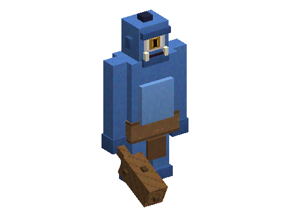 | [Cyclops](mods/cyclops/README.md) | A one-eyed giant shepherd at cave mouths, with its flock, its club and its boulders |
| 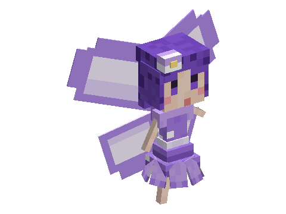 | [Fairies](mods/fairies/README.md) | Shy glowing fairies you befriend with glow berries: they circle your head, lighten your step and leave you fairy dust |
| 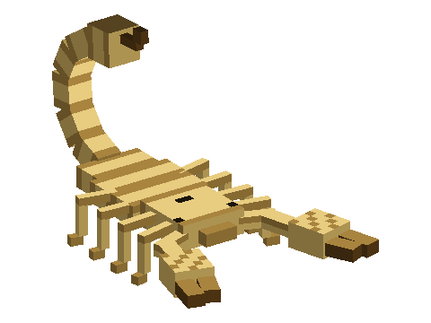 | [Scorpions](mods/scorpions/README.md) | Real-size scorpions in the shade of deserts, badlands and caves: they rear up when you come close and sting when hit; their stinger makes a dagger you throw |
| 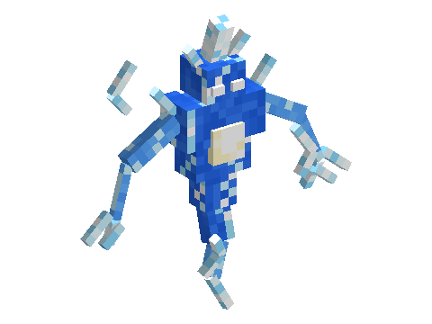 | [Storm Spirits](mods/storm_spirits/README.md) | Spirits of living lightning born in thunderstorms: they zap whoever hits them, and their sparks call lightning where you aim |
|  | [Vanilla Bestiary](mods/vanilla_bestiary/README.md) | Minecraft's own creatures in the creature guide's bestiary, found out as you meet them |

Every mod needs **[Sunrise Creatures](common/README.md)**, the library: it adds the glass jar, the creature guide and
the "Sunrise Creatures" creative tab, where all the series' items are.

<b>Planned</b>

- [Dung Beetles](mods/dung_beetles/README.md): beetles that roll dung balls under the stars and turn worn pastures
  back into grass.
- [Sporelins](mods/sporelins/README.md): shy mushroom sprites that tend a mushroom patch.
- [Seagulls](mods/seagulls/README.md): coastal food thieves that become fishing companions.
- [Living Flowers](mods/living_flowers/README.md): every small and tall vanilla flower come alive, to ambush you or
  guard you.
- [Jellyfish](mods/jellyfish/README.md): stinging jellyfish drifting in blooms, some glowing in the deep.
- [Flying Fish](mods/flying_fish/README.md): shoals that burst out of warm seas and glide over the waves.
- [Phasmids](mods/phasmids/README.md): stick and leaf insects hiding in the trees, a game of spotting them.
- [Magma Golem](mods/magma_golem/README.md): a six-block giant of living magma asleep in the Nether, a mini-boss to
  cool with snow.

## Install

You need **the Sunrise launcher**, from [playsunrise.net](https://playsunrise.net), and a Minecraft: Java Edition
account.

1. In the launcher's **Mods** page, find **Sunrise Creatures**: the collection installs every creature at once, or
   pick the ones you like (the library comes with them). Also at
   [playsunrise.net/mods](https://playsunrise.net/mods).
2. Press **Play**. These are native mods: the launcher builds the game with them the first time (a few minutes).

Each version is also a [release of this repository](https://github.com/EAnathos/sunrise-creatures/releases), signed:
`sunrise-launcher mods add-github <release link> --trust-native-code` installs one from there.

## In the game

- **The creature guide**: every player gets one the first time they join a world. Right-click it to open the
  **bestiary**: each creature you come across gets a page, turning in 3D, with the biomes you met it in, how rare it
  is and what you found out about it (what it eats, what catches it...).
- **The glass jar** (3 glass in a U and an oak slab, makes 2; only with Butterflies, Fireflies, Worms or Fairies
  installed): right-click a butterfly, a moth, a firefly, a worm or a fairy to catch it, right-click a block with the
  filled jar to release it. Released on a flower (or, for a worm, in a garden), it stays there. Sneak + right-click
  places the filled jar as a small glass jar holding the creature; fireflies and fairies make it glow.
- Monsters leave the series' creatures alone.
- Each mod's page tells you how to find and use its creatures.

Single player only for now; multiplayer comes later for the whole series.

## Build from source

The mods build with the repository's own tools (`cargo creature`, Rust) and Sunrise's `cargo sunrise-mod`:
[CONTRIBUTING.md](CONTRIBUTING.md) has the setup, the commands and the conventions, and
[docs/PUBLISHING.md](docs/PUBLISHING.md) how a version is released.

## Licence

[MIT](LICENSE). The sounds come from [freesound.org](https://freesound.org), under
[CC0](https://creativecommons.org/publicdomain/zero/1.0/).
