# Models

The Blockbench models of each mod, as built (at rest; the game poses them). Generated by `cargo creature preview` from `mods/<mod>/sources/models/*.bbmodel`: run it again after changing a model.

The `.bbmodel` files are the sources: edit them in Blockbench (their texture is embedded), then run `cargo creature model <mod> [model]` for the game and this command for the pictures. No script makes them.

## butterflies

### butterfly

`mods/butterflies/sources/models/butterfly.bbmodel`: 11 cubes, texture 64×64.

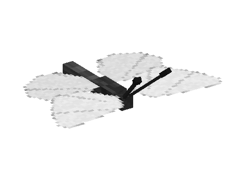 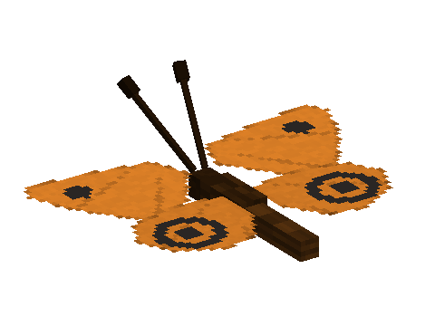

### moth

`mods/butterflies/sources/models/moth.bbmodel`: 9 cubes, texture 64×64.

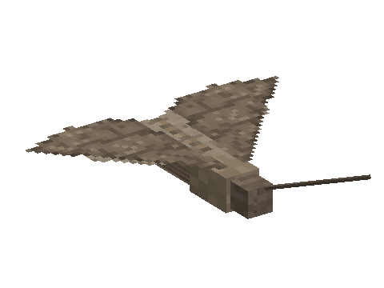 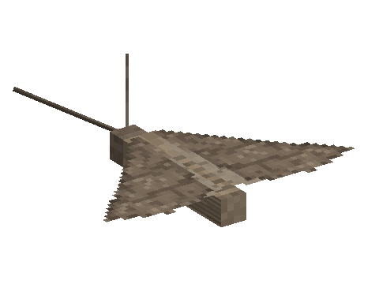

## cyclops

### boulder

`mods/cyclops/sources/models/boulder.bbmodel`: 8 cubes, texture 64×64.

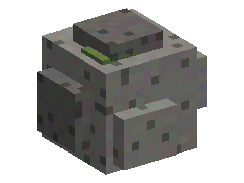 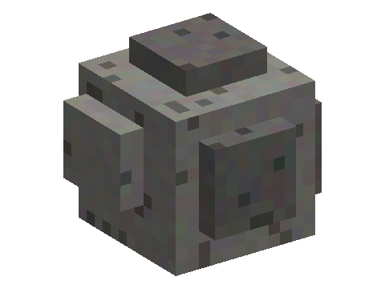

### cyclops

`mods/cyclops/sources/models/cyclops.bbmodel`: 31 cubes, texture 128×128.

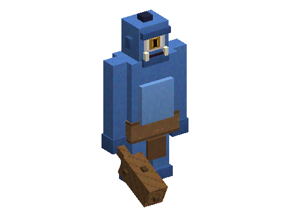 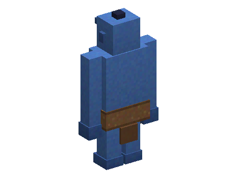

## dung_beetles

### dung_beetle

`mods/dung_beetles/sources/models/dung_beetle.bbmodel`: 30 cubes, texture 32×32.

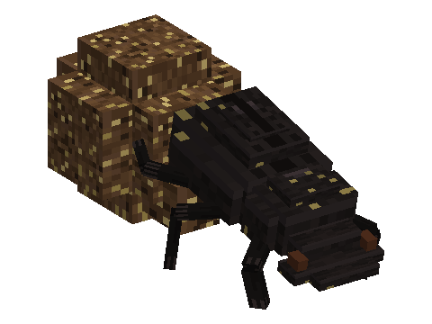 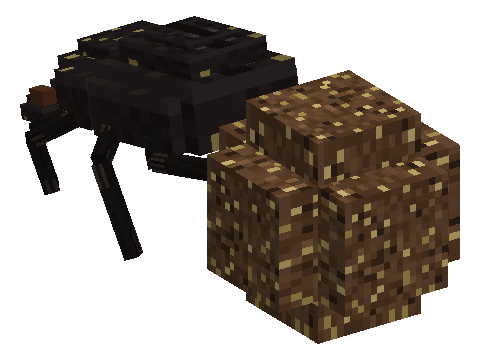

## fairies

### fairy

`mods/fairies/sources/models/fairy.bbmodel`: 38 cubes, texture 64×64.

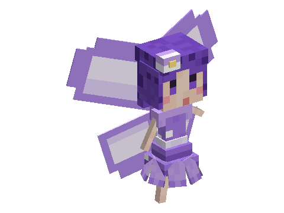 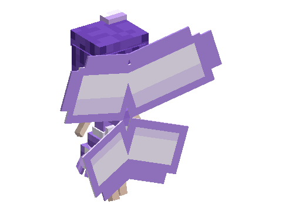

## fireflies

### firefly

`mods/fireflies/sources/models/firefly.bbmodel`: 10 cubes, texture 32×32.

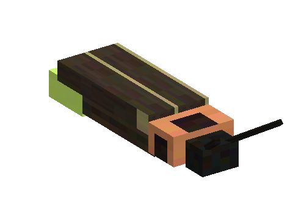 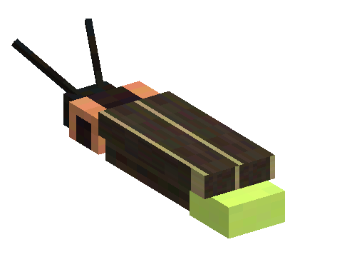

## flying_fish

### flying_fish

`mods/flying_fish/sources/models/flying_fish.bbmodel`: 17 cubes, texture 64×64.

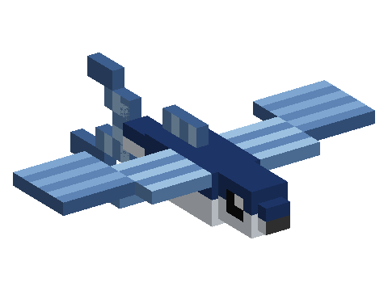 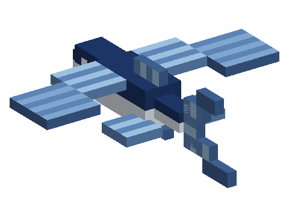

## jellyfish

### jellyfish

`mods/jellyfish/sources/models/jellyfish.bbmodel`: 65 cubes, texture 64×64.

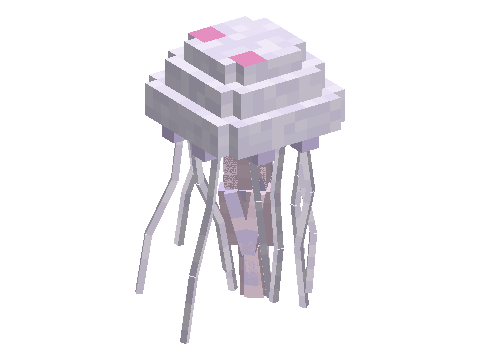 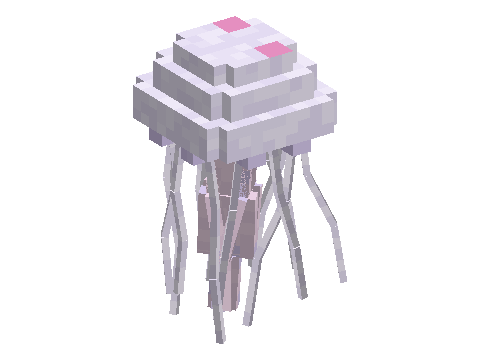

## living_flowers

### allium

`mods/living_flowers/sources/models/allium.bbmodel`: 14 cubes, texture 32×32.

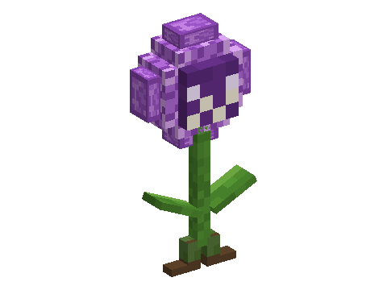 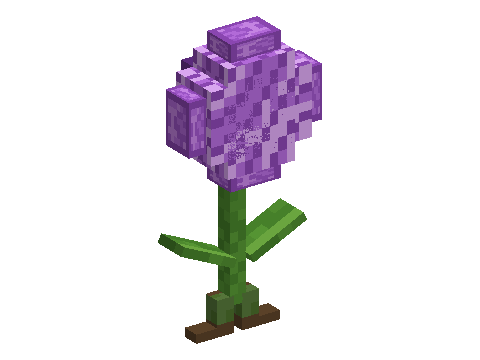

### azure_bluet

`mods/living_flowers/sources/models/azure_bluet.bbmodel`: 12 cubes, texture 32×32.

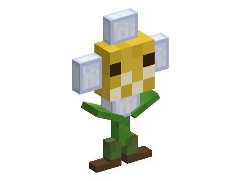 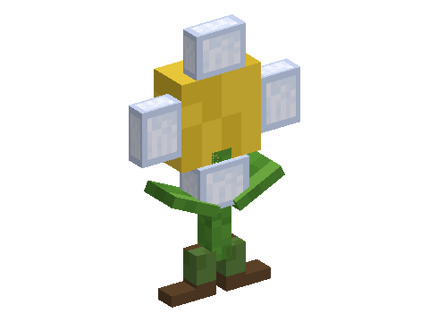

### blue_orchid

`mods/living_flowers/sources/models/blue_orchid.bbmodel`: 16 cubes, texture 32×32.

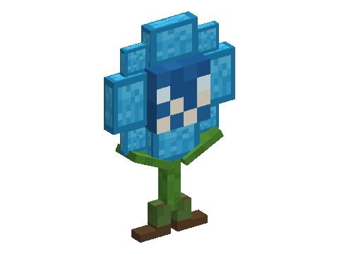 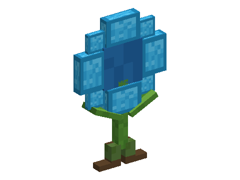

### cornflower

`mods/living_flowers/sources/models/cornflower.bbmodel`: 16 cubes, texture 32×32.

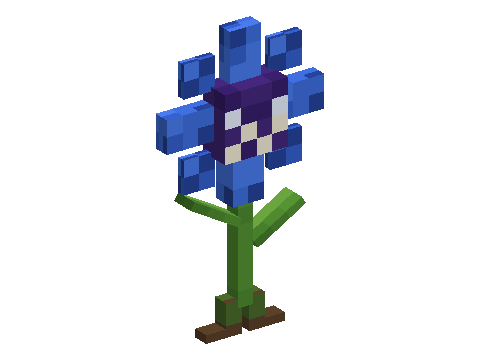 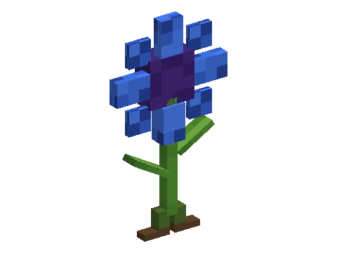

### dandelion

`mods/living_flowers/sources/models/dandelion.bbmodel`: 13 cubes, texture 32×32.

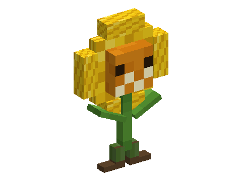 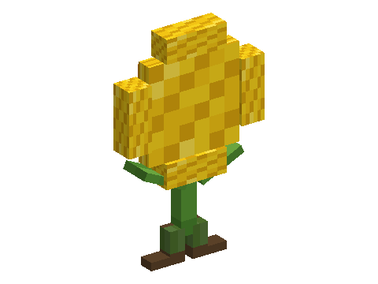

### eyeblossom

`mods/living_flowers/sources/models/eyeblossom.bbmodel`: 16 cubes, texture 32×32.

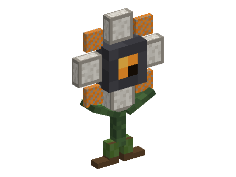 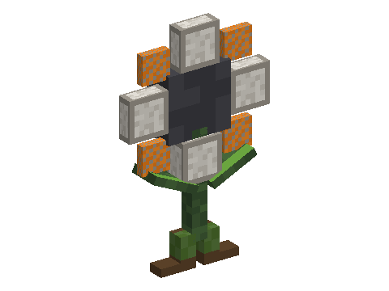

### lilac

`mods/living_flowers/sources/models/lilac.bbmodel`: 16 cubes, texture 32×32.

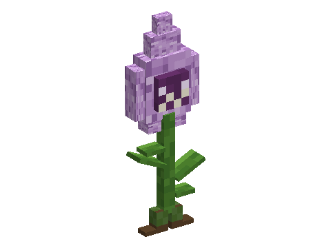 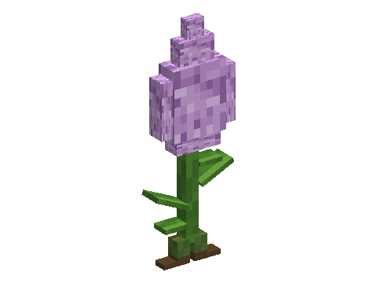

### lily_of_the_valley

`mods/living_flowers/sources/models/lily_of_the_valley.bbmodel`: 15 cubes, texture 32×32.

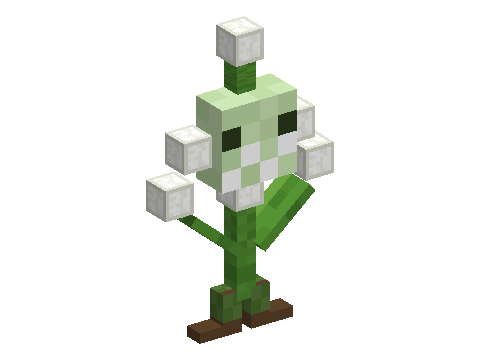 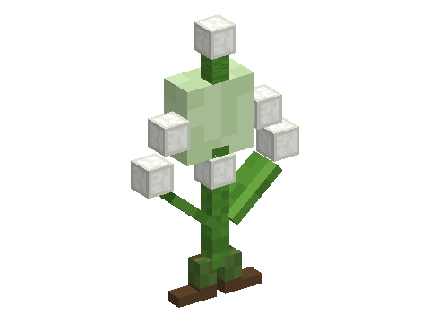

### oxeye_daisy

`mods/living_flowers/sources/models/oxeye_daisy.bbmodel`: 16 cubes, texture 32×32.

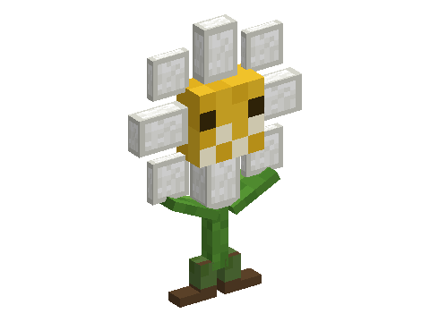 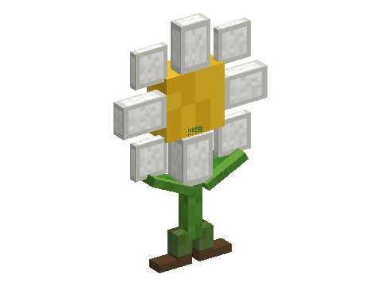

### peony

`mods/living_flowers/sources/models/peony.bbmodel`: 14 cubes, texture 32×32.

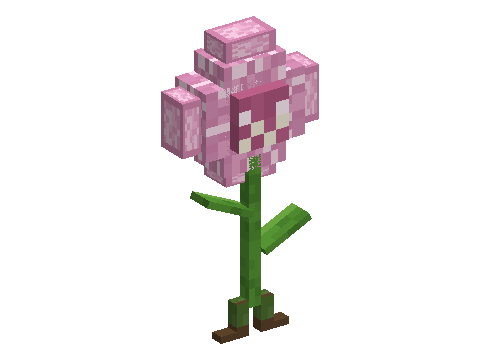 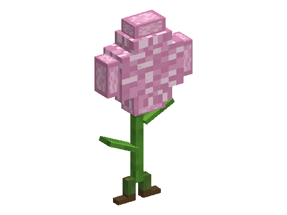

### pitcher_plant

`mods/living_flowers/sources/models/pitcher_plant.bbmodel`: 14 cubes, texture 32×32.

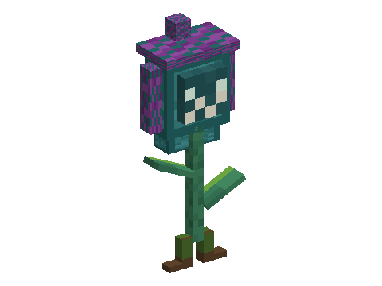 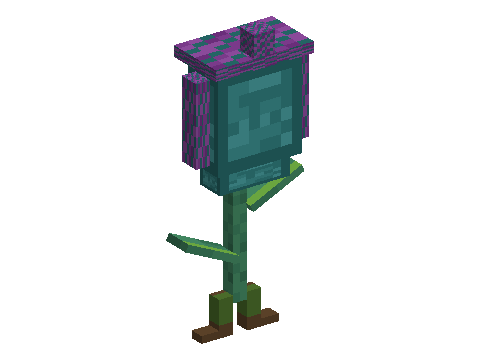

### poppy

`mods/living_flowers/sources/models/poppy.bbmodel`: 12 cubes, texture 32×32.

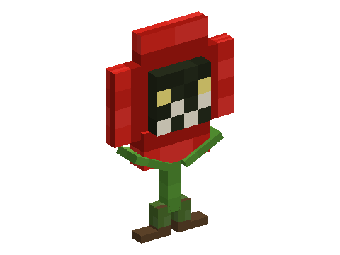 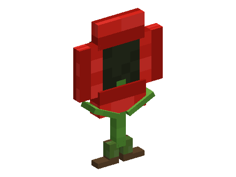

### rose_bush

`mods/living_flowers/sources/models/rose_bush.bbmodel`: 21 cubes, texture 32×32.

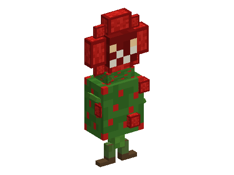 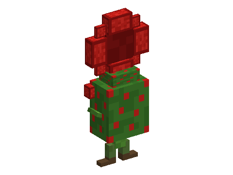

### sunflower

`mods/living_flowers/sources/models/sunflower.bbmodel`: 17 cubes, texture 32×32.

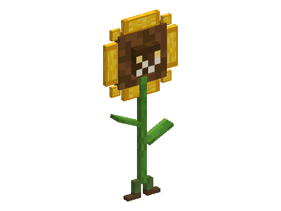 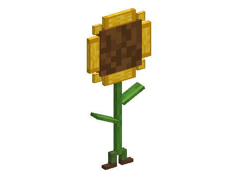

### torchflower

`mods/living_flowers/sources/models/torchflower.bbmodel`: 15 cubes, texture 32×32.

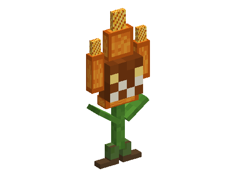 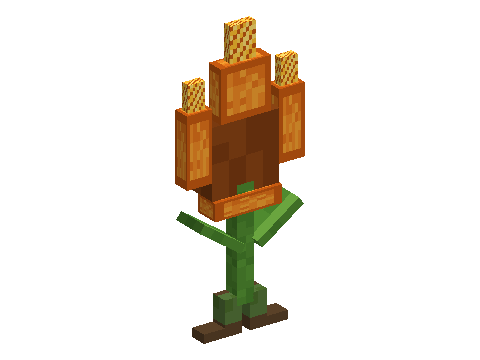

### tulip

`mods/living_flowers/sources/models/tulip.bbmodel`: 15 cubes, texture 32×32.

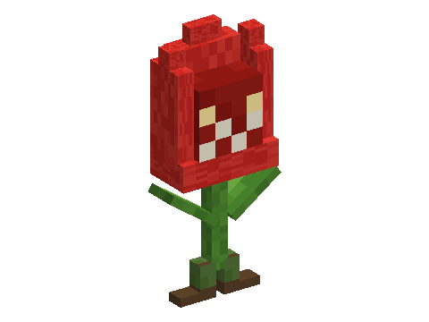 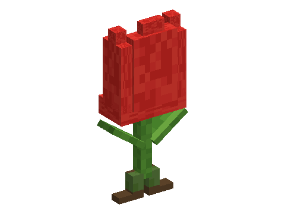

### wither_rose

`mods/living_flowers/sources/models/wither_rose.bbmodel`: 16 cubes, texture 32×32.

 

## magma_golem

### magma_golem

`mods/magma_golem/sources/models/magma_golem.bbmodel`: 48 cubes, texture 128×128.

 

## phasmids

### leaf_insect

`mods/phasmids/sources/models/leaf_insect.bbmodel`: 21 cubes, texture 64×64.

 

### stick_insect

`mods/phasmids/sources/models/stick_insect.bbmodel`: 24 cubes, texture 64×64.

 

## scorpions

### scorpion

`mods/scorpions/sources/models/scorpion.bbmodel`: 47 cubes, texture 64×64.

 

## seagulls

### seagull

`mods/seagulls/sources/models/seagull.bbmodel`: 18 cubes, texture 64×64.

 

## sporelins

### sporelin

`mods/sporelins/sources/models/sporelin.bbmodel`: 7 cubes, texture 32×32.

 

### sporelin_brown

`mods/sporelins/sources/models/sporelin_brown.bbmodel`: 7 cubes, texture 32×32.

 

## storm_spirits

### storm_spirit

`mods/storm_spirits/sources/models/storm_spirit.bbmodel`: 33 cubes, texture 64×64.

 

## vulture

### baby

`mods/vulture/sources/models/baby.bbmodel`: 24 cubes, texture 64×64.

 

### vulture

`mods/vulture/sources/models/vulture.bbmodel`: 37 cubes, texture 128×128.

 

## worms

### worm

`mods/worms/sources/models/worm.bbmodel`: 6 cubes, texture 32×32.

 
