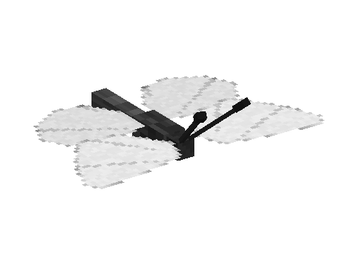
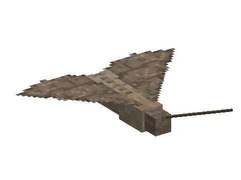

# Butterflies

 

A mod of the [Horizon Creature](../../README.md) series: butterflies by day and moths by night, in many colours and
patterns. **Requires** Horizon Creature, the series' library.

## Finding them

Butterflies flutter by day, in fair weather, in flower forests, meadows, plains, forests, birch forests, cherry groves
and jungles, landing on flowers. Moths come out at night in forests, taigas, plains and meadows, and circle around
torches and lanterns. Both fly off when you sprint at them. In creative: their spawn eggs (creative tab "Horizon
Creature").

Each butterfly has its own look: a colour (white, lemon, orange, red, sky blue, violet, brown, black) and a pattern
(plain, eye spots, wing tips, veins, dots, tails) in a second colour, some likelier in some biomes. The bestiary keeps
the ones you met.

## Jars and dust

- Catch one with a **glass jar** (right-click it) and release it on a block: it keeps its colours. Released on a
  flower, it stays around the flowers nearby. Sneak + right-click places the jar on display.
- **Butterfly dust** drops from both. Right-click to throw a shimmering cloud of it.
- **Confetti**: paper and butterfly dust make 8. Right-click to throw a burst of colours.
