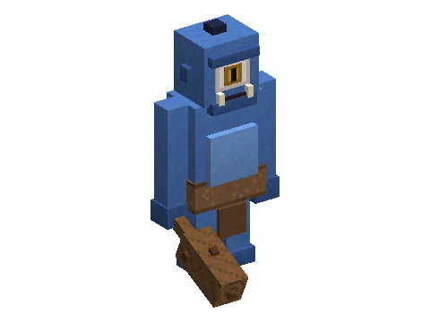

# Cyclops

A mod of the [Horizon Creature](../../README.md) series: a one-eyed giant shepherd, four blocks tall, who lives at the
mouths of caves with his flock. **Requires** Horizon Creature, the series' library.

## Meeting one

Rarely, at a cave mouth in the mountains, the meadows, the windswept hills or on a rocky shore, a cyclops watches over
three to five sheep that follow him everywhere. Never on Peaceful. In creative: the spawn egg (creative tab "Horizon Creature").

He is hostile. Come near, hurt him or one of his sheep, and he walks up and brings his club down on you (it hurts, and
throws you back). Keep your distance, or climb out of his club's reach, and he lifts a boulder over his head and hurls
it at you. Wherever the club or the boulder lands, the blocks around it break (chests and other containers are spared;
nothing breaks with the `mobGriefing` game rule off). His eye is his weak spot: an arrow
or a trident in it hurts twice as much and leaves him dazed for a moment.

## What he leaves

- **His eye**, when you kill him. With 4 sticks and wool it makes a **shepherd's crook**: while you hold it, the farm
  animals around you (sheep, cows, pigs, goats, chickens) follow you. His sheep too.
- Sometimes **his club**: a slow, heavy wooden weapon that hits hard and throws back. You can also make one from 4
  logs and a stick.
- Some leather.
