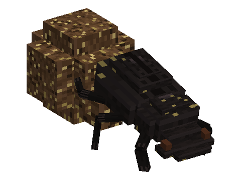

# Dung Beetles

A mod of the [Horizon Creature](../../README.md) series, **planned**: small beetles that follow grazing herds, roll
balls of dung in straight lines under the stars and bury them, turning worn ground back into grass. **Requires**
Horizon Creature, the series' library.

Not playable yet: the design is in [SPECS.md](SPECS.md).
