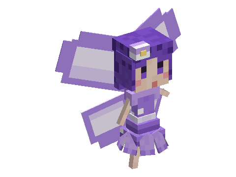

# Fairies

A mod of the [Sunrise Creatures](../../README.md) series: tiny shy fairies of the flowery woods and meadows, glowing a
soft violet. **Requires** [Sunrise Creatures](https://playsunrise.net/mods/creature), the series' library.

## Finding them

In flower forests, meadows, cherry groves and birch forests, little groups of fairies flit from flower to flower, day
and night (they rest in the rain); they are rare. They are shy: walk up to one and it flies off. Sneak, or hold out
berries, and they let you come near.
In creative: the spawn egg (creative tab "Sunrise Creatures").

## Befriending one

Hold out **glow berries**: a fairy nearby comes to hover before your face. Right-click it to give it one: one berry in
three, hearts, it is your friend. Sweet berries work too, less often.

Your fairy circles your head in sparkles and:

- lightens your step: **Speed I** while it is with you;
- leaves you a pinch of **fairy dust** at your feet once a day;
- softly lights up the night around you;
- comes back to you if you get far away, and never wanders off.

Right-click it to make it **stay** where it is, again to have it **follow** you. Your blows can't hurt it.

## Fairy dust

Your fairy's gift. It brews a **Potion of Swiftness** in a brewing stand, in place of sugar (awkward potion + fairy
dust).

## Jars

Catch a fairy with a **glass jar**, as the other creatures (yours only by you). It is still your friend when you let it
out, and keeps its name (shown on the jar). Release one on a flower and it stays there; place the filled jar (sneak + right-click) and it
glows.

## Credits

Its sounds are made from [CC0](https://creativecommons.org/publicdomain/zero/1.0/) recordings from
[freesound.org](https://freesound.org) (butterfly wings, fairy chimes, a giggle, sparkling stars).
