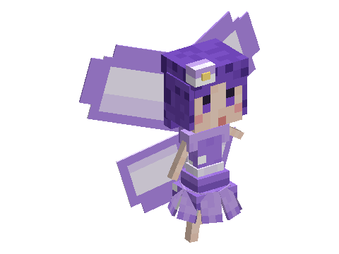

# Fairies

A mod of the [Horizon Creature](../../README.md) series, **planned**: tiny shy fairies of the flowery woods and
meadows, glowing a soft violet at dusk. Befriend one with glow berries and it follows you, circling your
head in sparkles and lightening your step with a gentle speed boost; it leaves you a pinch of fairy dust each day.
Kept in a glass jar, a fairy makes a lamp.
**Requires** Horizon Creature, the series' library.

Not playable yet: the design is in [SPECS.md](SPECS.md).
