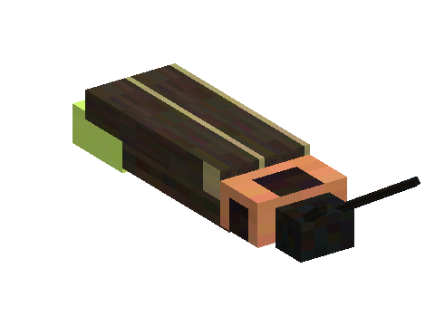

# Fireflies

A mod of the [Horizon Creature](../../README.md) series: fireflies that light up the night. **Requires** Horizon
Creature, the series' library.

## Finding them

At night, near swamps, rivers, plains, meadows and forests, fireflies drift low and slowly in small groups, their
lanterns pulsing yellow-green. By day they rest on the ground. In creative: the spawn egg (creative tab "Horizon
Creature").

## Jars

Catch one with a **glass jar** (right-click it). Release it on a flower and it stays there, lighting up your garden at
night; or place the filled jar (sneak + right-click) as a small glowing lantern.
