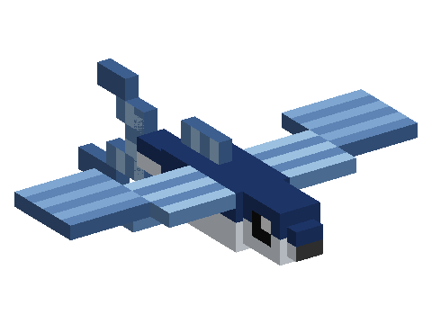

# Flying Fish

A mod of the [Horizon Creature](../../README.md) series, **planned**: shoals of flying fish in warm seas that burst out
of the water and glide over the waves on their wing-like fins, fleeing dolphins, boats and seagulls. Catch one in a
bucket or with a fishing rod, or cook it.
**Requires** Horizon Creature, the series' library.

Not playable yet: the design is in [SPECS.md](SPECS.md).
