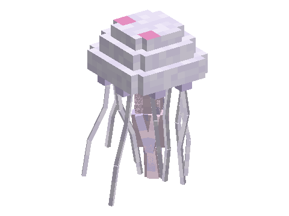

# Jellyfish

A mod of the [Horizon Creature](../../README.md) series, **planned**: jellyfish drifting in blooms through the oceans,
pulsing slowly and trailing long tentacles that sting what brushes them: pale moon jellies, amber sea nettles, and
glow jellies lighting the deep at night. Catch one in a bucket for an aquarium; their jelly makes slime balls.
**Requires** Horizon Creature, the series' library.

Not playable yet: the design is in [SPECS.md](SPECS.md).
