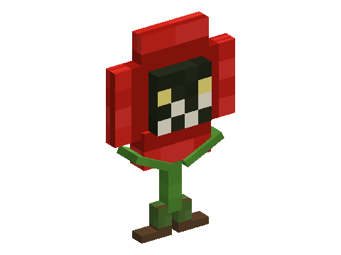

# Living Flowers

A mod of the [Horizon Creature](../../README.md) series, **planned**: every small and tall vanilla flower, from the poppy to
the sunflower, has a living kind that hides among the flowers of its biome and pulls up its roots to attack you when
you come close, each with its own attack. Give one a flower of its kind and it becomes your friend and guard; in a
flower pot, it sways and watches you. **Requires** Horizon Creature, the series' library.

Not playable yet: the design is in [SPECS.md](SPECS.md).
