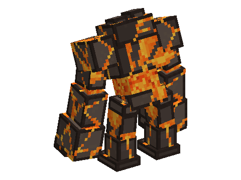

# Magma Golem

A mod of the [Horizon Creature](../../README.md) series, **planned**: a giant of living magma, six blocks tall, asleep
in the Nether as a mound of glowing rock until you come too close. A rare mini-boss with a boss bar: it slams, pounds
the ground and lobs magma, heals in lava, and crusts over under snowballs. Its magma heart turns a netherite pickaxe
into a molten pickaxe that smelts what it mines.
**Requires** Horizon Creature, the series' library.

Not playable yet: the design is in [SPECS.md](SPECS.md).
