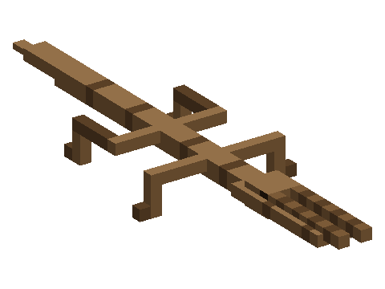
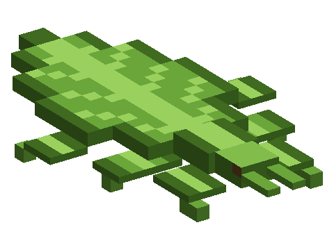

# Phasmids

 

A mod of the [Horizon Creature](../../README.md) series, **planned**: stick insects and leaf insects hiding in the trees
as twigs and leaves, still by day and swaying like a twig in the wind at night. Spotting them is the game: look closely
and they shimmer into view. Disturbed, they drop and play dead. Catch one in a glass jar and it settles on a tree of
your own. **Requires** Horizon Creature, the series' library.

Not playable yet: the design is in [SPECS.md](SPECS.md).
