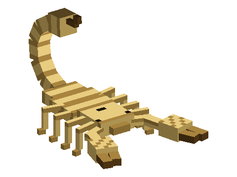

# Scorpions

A mod of the [Horizon Creature](../../README.md) series, **in development**: scorpions of real size hiding in the shade
of deserts, badlands and caves, where some glow cyan in the dark. Come close and one rears up, claws open and tail
arched; hit it and it fights back with its claws and a poisoned sting. Its venom makes poison potions and arrows, its
stinger a dagger, and a glass jar makes it a terrarium pet. **Requires** Horizon Creature, the series' library.

The code and content are in place; its textures and sounds are still to come, so it is not playable yet. The design is
in [SPECS.md](SPECS.md).
