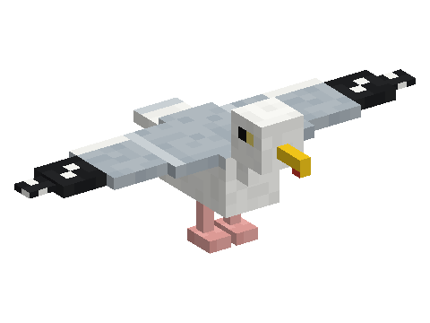

# Seagulls

A mod of the [Sunrise Creatures](../../README.md) series: noisy gulls of beaches and stony shores that glide along the
coast, bob on the waves, follow your boat and snatch food from your hand. Befriend one with fish and it becomes a
fishing companion. **Requires** [Sunrise Creatures](https://playsunrise.net/mods/creature), the series' library.

## Finding them

Flocks of 2 to 6 live on beaches, stony shores and snowy beaches. By day they soar along the coast, land on the sand,
the rocks or the roofs, and float on the water; at night they rest. They call often, and laugh now and then.

In creative: the spawn egg (creative tab "Sunrise Creatures").

## Thieves

Hold food in your main hand near a wild seagull and now and then it swoops down and snatches one, cooked fish and
bread above all, then flies off with it. Hit it and it drops it. It also takes food lying on the ground, and sometimes
the fish you just reeled in. Sneak, or keep the food in your off hand, and it leaves you alone. Sail out in a boat and
a seagull may follow you for a while, hovering behind you. Over warm seas, a seagull snatches a gliding flying fish in
the air when the [Flying Fish](../flying_fish/README.md) are installed.

## A fishing companion

Throw a raw cod or salmon near a wild seagull: it eats it, and one time in four it becomes your friend. It follows
you, never steals from you, and stays or follows again when you right-click it; a name tag names it. While you fish,
it circles over a lucky spot of water, calling: fishing there brings up no junk. About once a minute it flies out,
plunge-dives into the water and drops the fish it caught at your feet: a cod, sometimes a salmon, rarely a tropical
fish, and in the flying fish's oceans now and then a flying fish.

## Feathers and meat

Seagulls drop seagull feathers, which make arrows, a brush or a book and quill as a feather does, and raw seagull,
which cooks in a furnace, a smoker or on a campfire.
