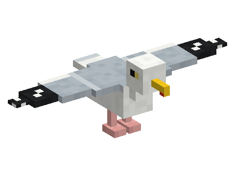

# Seagulls

A mod of the [Horizon Creature](../../README.md) series, **planned**: noisy gulls of beaches and harbours that glide
along the coast, bob on the waves, follow your boat and snatch food from your hand. Befriended with fish, one becomes a
fishing companion that dives for fish and circles over the best spot to cast. They drop feathers and meat.
**Requires** Horizon Creature, the series' library.

Not playable yet: the design is in [SPECS.md](SPECS.md).
