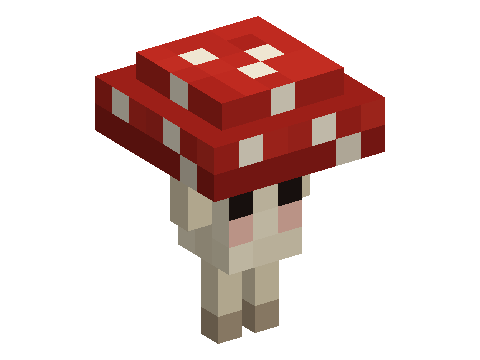

# Sporelins

A mod of the [Horizon Creature](../../README.md) series, **planned**: shy mushroom sprites of dark forests that pass for
a mushroom when you come near, plant mushrooms where they walk, and, befriended, tend a mushroom patch at your home, make you a mushroom stew each day and glow softly at night.
**Requires** Horizon Creature, the series' library.

Not playable yet: the design is in [SPECS.md](SPECS.md).
