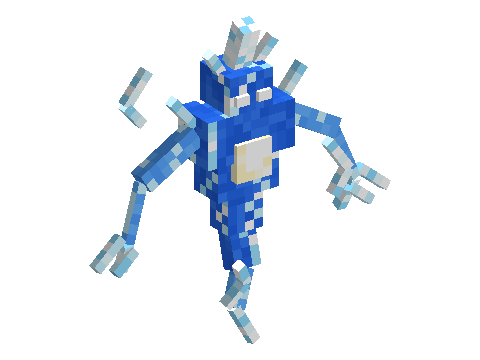

# Storm Spirits

A mod of the [Sunrise Creatures](../../README.md) series: spirits of living lightning, born in storms. **Requires**
Sunrise Creatures, the series' library.

## Finding them

In a thunderstorm, now and then a spirit appears where lightning strikes, in any biome, with a crackle of sparks. It
floats 1 to 4 blocks above the ground or the water, glowing blue, in short jerky dashes. When the storm ends it fades
within a few minutes. Only weather lightning gives birth to one: not a trident's, nor a command's. In creative: the
spawn egg (creative tab "Sunrise Creatures").

## Shocks

A spirit leaves you alone, but hit it and it dashes at you and zaps you (3 damage and a moment of Slowness), then
keeps away and comes back to zap you again every few seconds, until it loses you. Anything that touches it gets a
small zap. Lightning and fire don't hurt it.

## Sparks

A spirit drops 1 to 3 **sparks** (more with Looting). Right-click a spark to call a lightning bolt down on the block
you aim at, up to 32 blocks away, in any weather and any dimension: the spark is used up, with 2 seconds before the
next.
