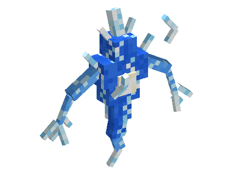

# Storm Spirits

A mod of the [Horizon Creature](../../README.md) series, **planned**: spirits of living lightning, now and then born
where a storm's lightning strikes, in any biome. They float in jerky dashes, glow and crackle, and shock whoever hits
them, then fade when the storm ends. Their sparks call a lightning bolt down where you aim.
**Requires** Horizon Creature, the series' library.

Not playable yet: the design is in [SPECS.md](SPECS.md).
