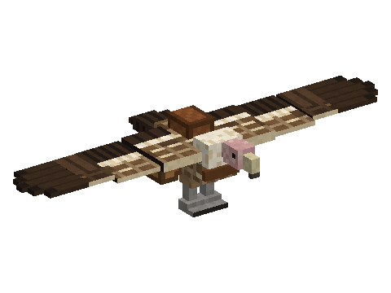

# Vulture

A mod of the [Horizon Creature](../../README.md) series: a desert vulture you tame with raw chicken, saddle and fly like
a plane, with two chests and talons. **Requires** Horizon Creature, the series' library.

## Finding one

Vultures live in deserts, badlands and savannas, where they soar in circles high up and land on the highest ground
around. In creative: the spawn egg (creative tab "Horizon Creature") or `/summon vulture:vulture`.

They are neutral: hit one and it dives at you from the air, with the vultures nearby. They drop feathers and meat (raw,
or cooked when they burn). A vulture feather crafts arrows, the brush and the book and quill like a feather.

## Taming

Throw raw chicken near it (Q): it walks to the meat and eats it, and one time in four it is yours (hearts). A tamed
vulture follows you in the air and lands near you, and defends you. Each vulture has its own health and speed.

Its owner's right-click:

- a **saddle** puts it on; then right-click to ride it;
- a **chest** adds one (two at most, saddle needed);
- raw meat heals it, or makes a baby grow faster;
- rotten flesh makes two grown vultures want a baby, which takes after both parents;
- anything else: sit or follow.

**Sneak + right-click** opens its screen: the saddle, sit / follow, and the chests' slots.

## Flying

It always flies forward and goes where you look, banking into its turns.

| Key | Effect |
|---|---|
| Look left / right | Bank and turn |
| A / D | Steer left / right |
| Space (held) | Climb; takes off from the ground |
| Sneak (held) | Descend |
| W | Flap, up to cruising speed |
| (nothing) | Glide, slowly losing height |
| S | Nothing in the air; on the ground, back up slowly |
| R | Talons: catch the small creature below, let it go |
| Sneak on the ground | Get off |

## Credits

Its sounds are made from [CC0](https://creativecommons.org/publicdomain/zero/1.0/) recordings from
[freesound.org](https://freesound.org) (hissing geese, wings, a vulture imitation).
