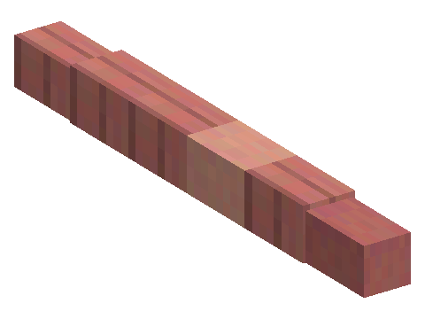

# Worms

A mod of the [Horizon Creature](../../README.md) series: earthworms you settle in your garden, where they help crops
grow. **Requires** Horizon Creature, the series' library.

## Finding them

Worms crawl on the grass of plains, meadows, forests and taigas, and many more come up while it rains. In creative: the
spawn egg (creative tab "Horizon Creature").

## Gardens

Catch a worm with a **glass jar** (right-click it) and release it on farmland, or on a crop, in a garden of at least
10 connected farmland blocks. It stays there, and every 20 seconds it makes one of the garden's crops grow a stage
(green sparkles show which). Up to 3 worms help a garden.
